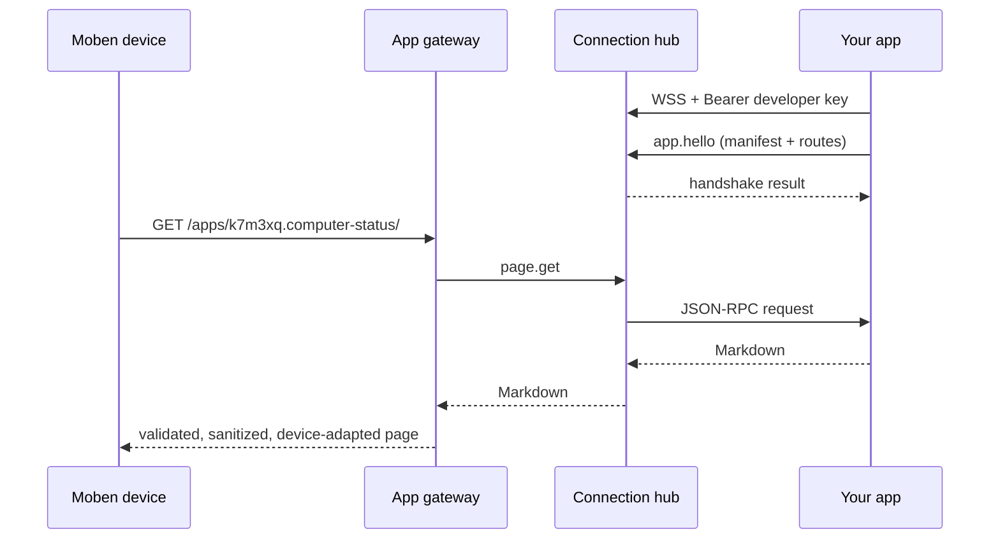

# Moben remote apps: SDK 0.6 and device protocol 2

V1 supports **private apps**: you run the app on your own computer or server, it connects out to the Moben cloud over WebSocket, and only the devices bound to your own account can see it.

Remote apps follow the same page, action, Action Sheet and tool contract as Moben's built-in Markdown apps. This document covers what is specific to remote apps: transport, identity and limits. The `@moben-ai/app-sdk` package implements all of it; most apps never touch the raw protocol.

## 1. Why a reverse WebSocket connection

Your computer usually sits behind a home or office router with no public address, so the cloud cannot reach it. Instead, the app opens a long-lived WebSocket to the cloud, the cloud sends JSON-RPC requests over it, and the app sends back results:

- One full-duplex connection lets the cloud send requests at any time. The app never listens on a port or needs firewall changes.
- Connected means online and disconnected means offline; no extra presence protocol is needed.
- Requests can run concurrently and be cancelled.

Devices never talk to the app directly. They only access the `/apps/*` gateway. Speech recognition and the language model always run in the Moben cloud; the app only provides pages, actions and tools.



## 2. Developer keys and app IDs

- On your computer, run `npx moben login` and approve the request in the browser: the CLI generates a developer key, sends the cloud only its digest, and saves it in `~/.config/moben/credentials.json`. On a server, run `npx moben login` once as the user that runs the app; over SSH it only prints the link. In containers or CI, copy the key from `~/.config/moben/credentials.json` into the `MOBEN_DEVELOPER_KEY` environment variable. One key serves every app of your account. Each login appears in Console under "Developer apps" as "CLI · <hostname>". An account can have up to 5 active keys; revoking one immediately disconnects every app using it.
- Each app declares its own `manifest.id`, such as `computer-status`, unique within your account. There is no separate registration step: the app appears in Console the first time it connects.
- Your first key also assigns your account a random namespace such as `k7m3xq`. The public app ID is `<namespace>.<manifest.id>`, for example `k7m3xq.computer-status`. It appears in device URLs and request contexts, reveals nothing about your account, and never needs to be written in code.
- Each account can have up to 10 apps. Stop an app before deleting it in Console; deleting frees its slot. An app that connects again with the same ID is registered again.
- A private app is available on every device bound to your account that is not in lost mode. You can turn it off per device in the device's app settings in Console.

## 3. Connecting

```text
GET wss://moben.cn/api/app-connect/ws
Authorization: Bearer mdk_xxxxxxxx
```

- An invalid key gets HTTP 401 and the connection is not upgraded.
- Each WebSocket text frame is one JSON-RPC 2.0 message (UTF-8 JSON). Batch arrays are not supported. A frame is at most 512 KiB.
- Each app keeps only one connection. When a new connection completes its handshake, the old one receives a `connection.replaced` notification and is closed with 4002. The SDK does not reconnect after 4002, so two processes never keep replacing each other.
- The cloud sends a WebSocket ping every 30 seconds and disconnects if no pong arrives by the next cycle. The app becomes offline as soon as the connection closes.
- After a disconnect, the SDK reconnects with exponential backoff and jitter, from 1 second up to 30 seconds. It stops reconnecting on 4001 (revoked), 4002 (replaced) and 4400 (invalid handshake).

Close codes:

| Code | Meaning |
| --- | --- |
| 1001 | The cloud is restarting or shutting down |
| 1011 | Internal cloud error |
| 4001 | Developer key revoked or app deleted |
| 4002 | Replaced by a newer connection for the same app |
| 4400 | Handshake failed (invalid manifest or routes) |
| 4408 | No handshake within 10 seconds |

## 4. Handshake: `app.hello`

After connecting, the app must send `app.hello` within 10 seconds. Until the handshake completes, the cloud sends no requests and accepts no other methods.

```json
{"jsonrpc":"2.0","id":1,"method":"app.hello","params":{
  "protocol":1,
  "sdk":{"name":"@moben-ai/app-sdk","version":"0.6.0"},
  "manifest":{"manifestVersion":1,"id":"computer-status","name":"Computer Status","version":"0.1.0","entry":"/","permissions":[],
    "locales":{"zh-CN":{"name":"电脑状态"}},
    "agent":{"instructions":"…","tools":[{"name":"get_computer_status","description":"Get the current configuration and live status of the user's computer.","external":true,"inputSchema":{"type":"object","properties":{}}}]}},
  "routes":{"pages":["/"],"actions":[],"progress":[]}
}}
```

Success:

```json
{"jsonrpc":"2.0","id":1,"result":{"appId":"k7m3xq.computer-status","mountPath":"/apps/k7m3xq.computer-status","heartbeatSeconds":30,
  "limits":{"messageBytes":524288,"pageBytes":262144,"toolResultBytes":8192,"pageTimeoutMs":10000,"toolTimeoutMs":15000}}}
```

On failure the cloud returns a `-32602` error whose `data.issues` lists every problem, then closes with 4400:

```json
{"jsonrpc":"2.0","id":1,"error":{"code":-32602,"message":"Invalid app manifest","data":{"issues":["manifest.id must be 2-31 lowercase letters, digits or hyphens, starting with a letter and not ending with a hyphen, such as \"computer-status\"","agent.tools[0]: name must be lowercase letters, digits or underscores, starting with a letter"]}}}
```

After a successful handshake the cloud stores the manifest and routes. The app list, the device status bar and the assistant's tools always use the latest handshake. While the app is offline, the last name and icon are still shown.

### 4.1 Manifest rules

- `id` is 2–31 lowercase letters, digits or hyphens, starting with a letter and not ending with a hyphen, such as `computer-status`. It is unique within your account; the cloud adds your namespace. If the account already has 10 apps, a new ID is rejected. `manifestVersion` is 1.
- `name`, `description` and `agent.welcome` are the English defaults. `locales['zh-CN']` may override `name` (up to 100 characters), `shortName` (up to 64), `description` and `welcome` (up to 200), and tool titles (`tools: { <tool name>: <title> }`, up to 40). Devices whose language is Chinese get the `zh-CN` values; all others get English. `locales.en` may override the English values.
- `permissions` may only contain `location` (city-level location).
- `entry` must match one of the page routes in `routes.pages`.
- At most 32 tools. Name them with lowercase letters, digits and underscores, starting with a letter, such as `get_computer_status` or `add_note` (up to 60 characters). The cloud shows them to the assistant as `app_<name>`, a prefix no platform tool uses, so they never clash with platform tools; requests to your app use your own names. Tools of different apps are never offered together: inside an app the assistant sees only that app's tools, and regular conversations reach them through `apps_call` with the app ID. `inputSchema` must be a JSON Schema with `type: "object"`, at most 8 KB when serialized.
- `agent.instructions` is at most 4000 characters and `agent.externalInstructions` at most 2000.
- Each tool may set `showCall: false` to hide its call icon, name and elapsed time in assistant replies. This optional boolean defaults to `true`. It applies both inside the app and through `apps_call` from other conversations. Execution, results, persistence, diagnostics and `uiEffects` are unchanged; the assistant still generates its final reply. This requires cloud support, not new device firmware. Reconnect the app after updating the manifest.
- `icon` is a single-colour SVG of at most 4 KB on a 24-unit grid. It must not contain scripts, external references, `<image>`, `<use>`, `<style>`, `<foreignObject>`, a DOCTYPE or entities, or `url(...)`. `lineIcon(shapes)` builds one in the official style.

### 4.2 Routes

`routes` declares the app's page, action, progress-report and voice routes. Routes start with `/`, and `:name` matches one path segment. Each kind allows up to 200 routes. The gateway validates against them exactly as it does for official apps:

- `action:` links and Action Sheet options in the page body must match `actions`; otherwise they become plain text or are rejected.
- `page.url`, `navigation.*` and the tool `open` UI effect must match `pages`.
- `readingProgress.reportUrl` must match `progress`. Device POSTs to those paths become `progress.post`; all other POSTs become `action.post`.
- `voice` lists `{ "route": "/tasks/:id/voice", "input": "audio" | "text" }` entries. A page's `voice.url` must match one of them, and recordings the device uploads there become `voice.start` (section 5.1).

The SDK generates the routes from the `pages`, `actions`, `progress` and `voice` passed to `defineApp`.

## 5. Requests from the cloud

Every request carries `params.context`:

```json
{
  "requestId": "6b413c5a-0c7a-4d00-aeef-ce82713dc008",
  "appId": "k7m3xq.computer-status",
  "mountPath": "/apps/k7m3xq.computer-status",
  "openId": "od_3k7q9x2m4n8p6r5t1v0w",
  "locale": "en-US,en;q=0.9",
  "timezone": "America/Los_Angeles",
  "location": { "city": "San Francisco", "province": "California", "country": "United States" },
  "client": { "width": 460, "height": 700, "textPixelSize": 28, "features": ["markdownApps"], "protocol": 2 }
}
```

- `locale` is the device language as an `Accept-Language` value. Pass the context to a translator from `createAppTranslator`, or call `resolveAppLocale(ctx)` to get `'en'` or `'zh-CN'`.
- `timezone` is the device's IANA time zone. Use it to format dates and times.
- `openId` is a stable pseudonymous identifier for this device within your app; see section 7.
- `location` is present only when the manifest declares the `location` permission and the device has a location. It is city-level only.
- Apps never receive device IDs, accounts or phone numbers.

| Method | Parameters (besides `context`) | Result |
| --- | --- | --- |
| `page.get` | `url`, `path`, `query`, `route`, `params`, `stream: true` | `{ "markdown": "…" }`, or `page.chunk` notifications then `{ "done": true }` |
| `action.post` | `url`, `path`, `query`, `route`, `params`, `currentPage`, `body`, `requestId` | `{ "path": "<page URL>", "initialFocus"?, "startMode"? }`, or `{ "markdown": "…", "initialFocus"?, "startMode"? }` |
| `progress.post` | `url`, `path`, `query`, `route`, `params`, `report` | `{ "accepted": true }` |
| `tool.call` | `name`, `arguments`, `requestId`, `page` | `{ "result": …, "uiEffects"?: [ … ] }` |
| `voice.start` | `url`, `path`, `query`, `route`, `params`, `currentPage`, `requestId`, `input`, `format`?,  | `{ "kind": "accepted" }`, or a page as for `action.post`; see section 5.1 |

Fields:

- `url` is the full normalized address including the mount path and query string. `path` is the app path without the mount path. `query` is the query string (`?a=1` or an empty string). `route` is the matched route template and `params` holds the route parameters.
- The current SDK returns the destination from `action.post`: `{ path, initialFocus?, startMode? }` after the operation. The gateway opens it with the same `page.get` stream. SDK 0.4 action replies may instead include `markdown`, which enters the same pipeline directly with its focus and mode. `requestId` deduplicates the mutation, independently of rendering.
- In `tool.call`, `name` is the tool name you declared (`get_computer_status`, not `app_get_computer_status`), and `page` is a snapshot of the page the device had committed when the voice key was pressed. It can be `null`, for example when the tool is called from a regular conversation through `apps_call`. `requestId` is used to deduplicate tools that change data. `result` is at most 8 KB when serialized. `uiEffects` supports `open` and `reload`.
- When the cloud gives up on a request (the device disconnected or it timed out), it sends the notification `{"jsonrpc":"2.0","method":"$/cancel","params":{"id":"<request id>"}}`. Stop the work as soon as possible; later results are ignored. In the SDK, this aborts `ctx.signal`.
- All pages use one gateway pipeline on current device protocol 2. SDK 0.6 sends `page.chunk` notifications followed by `{ done: true }`; SDK 0.4 may return `{ markdown }` as one completed chunk. The gateway does not require a minimum SDK version. It always sends `stream: true` as a capability hint for SDK 0.5; older SDKs may ignore it.
  - The app may send any number of notifications `{"jsonrpc":"2.0","method":"page.chunk","params":{"id":"<request id>","markdown":"…"}}` and then finish with the result `{ "done": true }`. `id` is the JSON-RPC id of the `page.get` request. Chunks may split anywhere; joined together they form the page, starting with the metadata line.
  - The app decides when the page ends. After the first chunk there is no time limit, and the app may stay silent for as long as it needs; the device shows that the page is still loading. When the device leaves the page, the cloud sends `$/cancel`.
  - The current SDK returns `{ "path": "<page path>", "initialFocus"?, "startMode"? }`. The gateway then opens that page with a streaming `page.get` and applies the focus and mode. A legacy completed `markdown` reply uses the same renderer without another GET; receipts retain only the destination, so retries fetch it without repeating the action.
  - With the SDK, a page handler returns an `AsyncIterable<string>`, for example an `async function*`. The SDK merges, sends and cancels for you. Returning a string uses the same stream as a single chunk.

### 5.1 Voice input

A capture page starts the existing `voice.start` RPC while the device uploads. Route arguments, `currentPage`, `requestId` and `input` are unchanged. The result is `{ kind: 'accepted' }` or an action-style page destination. Apps can refuse early; after normal `voice.end` they have 60 seconds to reply.

- Text routes get no `voice.transcript` notifications. `voice.end` carries `{ complete: true, durationMs, transcript, language }`. `speech.done` resolves as before and the compatibility `speech.transcripts` iterator yields the final words once. Interrupted text uploads are cancelled instead of submitting partial instructions.
- Device live transcription is independent. Without echo the cloud uses non-realtime ASR; with echo it may use realtime ASR for supported languages.
- Audio routes keep `recording.chunks` and `recording.done`. `voice.audio` carries base64 Ogg/Opus bytes, a sequence number and optional cumulative `durationMs`; normal `voice.end` reports `complete: true`, an interrupted upload reports false.
- If the API WebSocket closes, the SDK finishes the audio iterator with its received bytes and resolves `done` with `complete: false`, leaving the audio handler's `ctx.signal` usable so it can save the partial recording. The last reported duration is used; older clouds may leave it at 0 (unknown). The SDK does not resume or replay recordings. Text and other requests still abort.
- Explicit `$/cancel` always aborts the handler and rejects `done`, including audio. Your app decides how to store incomplete recordings or discard cancelled ones.
- Device protocol remains 2 and the handler API is unchanged. No acknowledgement, retry or persistence protocol is added.

### 5.2 Errors

When the app returns a JSON-RPC error, `message` is shown to the user (up to 200 characters), so write it for the user and in the user's language:

```json
{"jsonrpc":"2.0","id":"c-17","error":{"code":-32000,"message":"This item has been deleted.","data":{"httpStatus":404}}}
```

`data.httpStatus` may be 400, 403, 404, 409, 410, 422 or 429; the gateway returns that status to the device. 404 tells the device the resource no longer exists. A missing or other value is treated as 502.

With the SDK, `throw new AppRequestError(status, message)`. Any other exception shows a generic, localized error on the device and logs the details on your machine.

### 5.3 Deduplication and idempotency

- The gateway merges repeated `action.post` and `mutates: true` `tool.call` requests with the same device, app, kind and request ID, and caches the result for five minutes. A cache hit does not call the app again.
- Exactly-once execution is not guaranteed after a cloud restart or once the cache expires. Deduplicate non-idempotent operations (such as adding an item) in the app by `requestId` or a business key. The SDK keeps a similar five-minute cache.

## 6. Gateway behavior

- **Page validation**: remote pages go through the same sanitizer as official apps: the metadata line, link boundaries (only this app and `/apps/`), Action Sheets, HTML comment stripping, the 512 KiB limit, and table and LaTeX conversion. External links and external images are reduced to plain text.
- **Page output**: every page uses incremental validation and the conversation Markdown pipeline. Completed lines use the existing conversation Markdown conversion; the final unfinished line is flushed at completion. Links, images and hidden declarations pass the same validation. The page limit is 512 KiB. Metadata goes first; the device resolves initial focus when its link is available.
  - The page timeout applies until the first chunk arrives, so send the metadata line right away. After that there is no time limit: the stream lasts until the app ends it, the device leaves the page, or the app disconnects (a missed WebSocket ping, see above).
  - If something fails after the page has started (an app error, the size limit), the gateway cuts the response; the device keeps what it received and says the page is incomplete.
- **Voice input**: the gateway forwards the recording while the device uploads it and checks that it is valid Ogg/Opus. Recordings have no length limit unless the page sets `voice.maxSeconds`. Text-mode recognition counts toward the device owner's Moben usage, like a voice question to the assistant; when the usage limit is reached, the recording is refused and the device says so. Devices that cannot record into apps do not receive the page's `voice` settings, and their voice key keeps opening the assistant.
- **Timeouts**: pages, actions and progress reports 10 seconds (for streaming pages, until the first chunk); tools 15 seconds; voice input none while recording, then 60 seconds after `voice.end`. Each app can have at most 32 requests in flight; more get 429.
- **Offline**:
  - In the app list, private apps come after official apps and are marked as offline while disconnected. They can still be opened.
  - Opening any page of an offline app shows a platform offline notice that refreshes every 30 seconds. Once the app is back online, the device shows the real page on the next refresh.
  - Actions and progress reports return 503 while offline. A disconnect mid-request also returns 503, and a timeout returns 504; the device keeps its current page.
  - While offline, the app's tools are not offered to the assistant, and `apps_describe` / `apps_call` do not list its external tools. If the app goes offline during a call, the assistant is told the app is offline.
- **AI trust boundary**: instructions, tool results and page content from non-official apps are treated as untrusted third-party data. They cannot override platform or safety rules. Sensitive platform tools, such as memory, conversation search and image generation, are never available inside non-official apps.
- **Rate limits**: per-device, per-app request limits apply.

## 7. Device identifier: openId

- The same device always gets the same `openId` in the same app. Different apps get different values, so apps cannot link the same device across apps.
- Moving a binding to new hardware keeps the `openId`. Unbinding and binding again produces a new `openId`, just as a fresh binding does not inherit old data.
- Every page, action and tool request carries the `openId`. Keep each device's records under it, for example as a key in a JSON file or an `open_id` column, so the app stays correct when several devices use it.

## 8. Using the SDK

```ts
import { AppRequestError, connect, createAppTranslator, defineApp, md, page } from '@moben-ai/app-sdk';

const text = createAppTranslator({
  en: { title: 'Notes', clear: 'Clear all' },
  'zh-CN': { title: '笔记', clear: '全部清除' }
});

const app = defineApp({
  manifest: { manifestVersion: 1, id: 'notes', name: 'Notes', version: '0.1.0', entry: '/', permissions: [],
    locales: { 'zh-CN': { name: '笔记' } },
    agent: { instructions: '…', tools: [/* { name: 'add_note', … } */] } },
  pages: { '/': ctx => page(ctx, { title: text(ctx, 'title') }).heading(text(ctx, 'title')).raw(md.action(text(ctx, 'clear'), ctx.url('/clear'))).toString() },
  actions: { '/clear': async ctx => { /* … */ return ctx.renderCurrentPage(); } },
  tools: { /* add_note: async (ctx, args) => ({ result: …, uiEffects: [{ type: 'reload' }] }) */ },
});

connect(app); // uses MOBEN_DEVELOPER_KEY or the key saved by `moben login`
```

- The assistant chooses tools by name and description. Name them verb first after what they do (`get_computer_status`, `add_note`), and say in the description what the tool returns and when to use it. Vague names such as `info` or `run` get called less reliably.
- `defineApp` and `connect` run the cloud's handshake checks locally, so manifest mistakes are reported before connecting.
- `npx moben app validate`, `npx moben app page <path>`, `npx moben app action <path>` and `npx moben app tool <name>` run your app locally with the gateway's page and effect checks, without connecting. See the README for options. `npx moben app page <path>` prints a streaming page part by part; Ctrl-C leaves the page like the device does. `npx moben app voice <path> --text "…"` (text routes) or `--file recording.ogg` (audio routes) records into a voice route from the page given with `--page`.
- Several apps can run in one process: call `connect()` once per app with the same key.
- Build in-app links with `ctx.url(path)`.
- Action handlers return `ctx.renderCurrentPage()` or `ctx.renderPage(path)`. The SDK renders the target page locally and returns it in the same round trip.
- English is the default language. Put every user-visible string in a `createAppTranslator({ en, 'zh-CN' })` table and localize the manifest with `locales['zh-CN']`, so devices set to Chinese show Chinese.
- The SDK checks required fields, top-level types and enums against each tool's `inputSchema`. The cloud does not compile your JSON Schema, so validate finer rules in the handler.
- The SDK connects to `wss://moben.cn/api/app-connect/ws` by default. Override it with the `url` option or the `MOBEN_APP_CONNECT_URL` environment variable.

A minimal example ships in this package under `examples/machine/`: "Computer Status" reads the OS, processor, memory, disk, CPU usage and LAN IP of the computer it runs on using only built-in Node modules, and works on macOS, Linux and Windows. Its page refreshes every minute, shows English or Chinese according to the device language, and its tool answers "What are my computer's specs?" both inside the app and in regular conversations.

## 9. Pages on the device

The device has a 3.97-inch grayscale e-ink screen. At the default font size a line holds about 16 Chinese characters or 30 Latin characters, and a screen about 15 lines; users can choose other font sizes. Every refresh is slow and visible, so keep pages short, put what matters on the first screen, and avoid content that changes on every request.

Markdown the device renders:

- Headings `#` to `######`, paragraphs, `**bold**`, `*italic*`, inline code, fenced code blocks, quotes `>`, unordered lists `-`, rules `---` and links. `**`, `*` and backticks must open and close on the same line, and a link must fit on one line.
- Images only as ``. Use black-and-white or grayscale PNGs no wider than the screen; external images are removed.
- The gateway converts tables (into lists) and LaTeX. Ordered lists (`1.`) show as plain text, and HTML is not supported.
- Unicode symbols such as ✓ · → render, and so do emoji, in black and white. There is no color.
- With the `page(ctx)` builder, `heading`, `paragraph` and `quote` escape text for you. `list` and `raw` insert their input verbatim, so wrap user text in `md.text()`; use `md.bold()`, `md.link()` and `md.action()` inside them.

Navigation and focus:

- Links are the only elements the user can select. Pages open in reading mode: left and right turn screens, and a short press of the voice key starts selecting from the first link on the current screen. Pages returned by an action stay in selection mode unless they set `startMode: 'read'`.
- Each link costs a key press to reach, so keep links per screen few and put the main ones first. For per-item menus, declare an Action Sheet with `md.actionSheet({ id, title, items })` and link to it with `md.actionSheetLink(text, id)`; it opens locally without a request. Items may include `selected: true` for the current choice (at most one). On supported firmware, opening the menu focuses that item and shows its screen; without it the first item is focused. A checkmark in the text is only a visual label, and focusing an item never executes its action.
- `md.action(text, ctx.url('/path'), { confirm: '…' })` makes the device ask for confirmation first; left cancels, right confirms. Use it for deletions and anything hard to undo.
- An action's feedback is the page it returns: the item moves, the check mark appears, the count changes. Do not add banner lines or messages; they push the page down and cost an extra refresh.
- After an action, choose the focus with `ctx.renderCurrentPage({ initialFocus })` or `ctx.renderPage(path, { initialFocus })`. The value is a link target exactly as it appears on the returned page: `ctx.url('/items/42')` for a page link or `` `action:${ctx.url('/items/42/done')}` `` for an action link. A good default is the item after the one just handled.
- `page(ctx, { navigation: { parentPage: ctx.url('/') } })` sets where the back key goes when the user opened this page directly, for example from a tool. `navigation.previousPage` and `nextPage` link a sequence of short pages to the left and right keys.
- `page(ctx, { refresh: { intervalSeconds: 60 } })` reloads the page in the background, at most every 30 seconds.

Streaming pages:

- For content that keeps growing, such as a task log or a long answer, write the page handler as an `async function*` that yields the metadata line first and then text as it arrives. Each `yield` may be any piece of text; the SDK merges small pieces.
- Every page is incremental by default. No `interaction.follow` field is needed. Set `interaction.autoPage` only when new screens should follow while the reader is on the last screen.
- Return when the content is complete. Stop work when `ctx.signal` aborts: the user left the page. Whether the page reopens later is up to its `refresh` setting.
- Inside a streamed page, use `ctx.setActivity(state)` with `waiting` (unknown phase), `thinking` (explicit upstream reasoning), `executing` (active tools or commands), `waitingApproval` (upstream approval needed), `waitingInput` (upstream user input needed), or `idle` (clear the status). Only report a specific phase when upstream events establish it; an active task or a quiet stream alone is not evidence of thinking. Blocking approval/input states take priority over work. Track each parallel item through its own start/completion events and clear all work on turn completion or disconnect. Waiting uses the neutral localized label “Waiting” / “等待中”; explicit thinking uses “Thinking” / “正在思考”. This reports state through a separate `page.activity` notification (`{ id, state }`, using the active request ID), never Markdown. For device protocol 2 with `appPageActivity` in `ctx.client.features`, the cloud owns the localized label and one-second dot animation as pending text at the document end, using the same UTF-8 backspace rewrite as conversation output. It erases the prior frame before replacement, real content or completion; the footer keeps its page counter. Completion, cancellation and disconnect clear it. The SDK ignores these calls for older devices and non-streamed pages; do not add a permanent “working” paragraph.

```ts
pages: {
  '/log': async function* (ctx) {
    yield page(ctx, { title: 'Build', interaction: { autoPage: false } }).heading('Build').toString();
    for await (const line of build.output({ signal: ctx.signal })) yield `${md.text(line)}\n\n`;
  },
},
```

Voice input:

- By default, holding the voice key opens the assistant, which can call your tools. A page can instead send what the user says to your app with `page(ctx, { voice: { mode: 'capture', url: ctx.url('/notes/voice') } })`, or turn the voice key off with `voice: { mode: 'off' }`.
- On a capture page the user holds the voice key to talk and releases it to submit. While holding, the right key locks the recording, so the user can let go and keep talking; a short press of the voice key then submits. The left key cancels. Set `lock: false` to keep recordings hold-to-talk only. `hint` (up to 40 characters) is shown while recording, for example "Say the next step". `maxSeconds` submits automatically at that length; without it there is no limit.
- Declare each recording URL in `voice` with the input you want. `input: 'text'` receives the words recognized by the Moben cloud; `input: 'audio'` receives the recording itself, for your own speech recognition or to keep it.

```ts
voice: {
  '/notes/voice': {
    input: 'text',
    handler: async (ctx, speech) => {
      const { transcript } = await speech.done;
      await notes.add(ctx.openId, transcript);
      return ctx.renderCurrentPage();
    },
  },
  '/memos/voice': {
    input: 'audio',
    handler: async (ctx, recording) => {
      const file = createWriteStream(memoPath(ctx.openId, ctx.requestId));
      for await (const chunk of recording.chunks) file.write(chunk);
      file.end();
      const { complete, durationMs } = await recording.done;
      await memos.add(ctx.openId, { complete, durationMs });
    },
  },
},
```

- In text mode, `speech.transcripts` yields the final transcript once, then ends. `await speech.done` gives `{ transcript, language, complete, durationMs }`.
- In audio mode, `recording.chunks` yields the Ogg/Opus bytes in order while the user speaks; read it once. `await recording.done` gives `{ complete, durationMs }`. `complete` is false when the device lost its connection; the part that arrived is still delivered.
- Return nothing when the page shows the outcome itself, for example a streaming page that is open on the device. Return `ctx.renderCurrentPage()` or `ctx.renderPage(path)` to show a page, as an action does.
- Return only after `done` resolves. Returning or throwing earlier stops the recording, so do that only to refuse, for example `throw new AppRequestError(409, text(ctx, 'busy'))` when the task cannot take input now.
- When the user cancels, `done` rejects, `chunks` and `transcripts` throw, and `ctx.signal` aborts.
- The recording panel covers only the bottom of the screen, and a streaming page keeps running while the user speaks. Streaming pages only grow, so write the final transcript into the page rather than every partial value.
- `page()` drops `voice` for devices that cannot record into apps; they keep the assistant. Check `ctx.client.protocol >= 2` to offer another way in, such as an action link.

## 10. Data, time and tool results

- Keep data on the machine that runs the app: a JSON file for a few records, or a local database such as SQLite for structured or growing data (`node:sqlite` is built into Node 22.13 and newer; on older versions use the `better-sqlite3` package).
- Put data files next to your app code, for example in a `data/` folder resolved from the app file (`__dirname`, or `import.meta.dirname` in ES modules), not relative to the current directory: the app may be started from anywhere. Write JSON files atomically (write a temporary file, then rename it).
- Keep each device's records apart by `ctx.openId`, as the starter's notes do. Share only data that belongs to everyone using the app, such as its settings.
- Compute "today" and format dates with `ctx.timezone` and `ctx.locale`, never the computer's time zone. Tools should accept relative dates such as `daysAgo` rather than asking the assistant for a calendar date.
- Tool results are data for the assistant: keep them in English, small (under 8 KB) and structured, and the assistant answers in the user's language. When the request is fine but nothing matches, return that as data with what is available, for example `{ found: false, habits: ['running', 'reading'] }`, so the assistant can ask a follow-up question. Throw `AppRequestError(400, message)` for invalid input; the assistant receives the message.
- Messages in `AppRequestError` thrown from pages and actions are shown to the user, so translate them with `text(ctx, …)`.
- `createAppTranslator` has no plural rules. Use separate keys such as `days_one` and `days_other` for English.


### Optional automatic paging (device protocol 2)

Set `interaction: { autoPage: true }` to follow new screens. Omission or `false` keeps manual paging. A new page starts at the received tail unless an explicit location takes priority. Reading an older screen pauses following; returning to the last screen resumes it. Temporary tail erasure does not resume paused following. Selection, overlays and pending explicit locations keep their current view. This option is independent of stream lifetime and changes neither reading mode nor refresh/history/progress policy. The gateway ignores invalid types and reports a developer diagnostic. Older beta clients must update.
